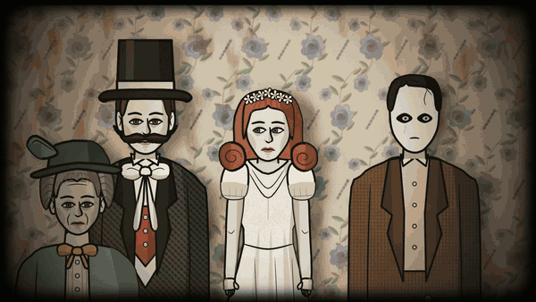
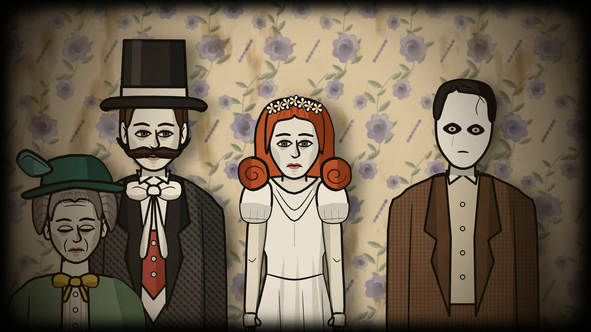
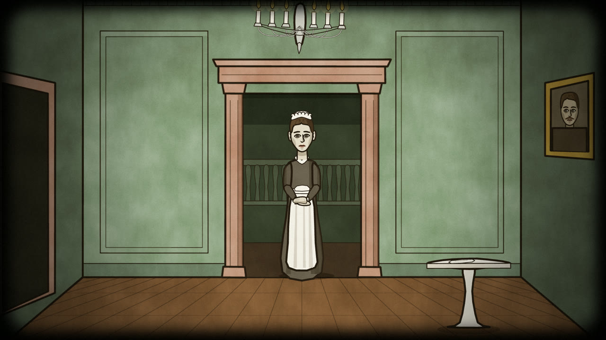
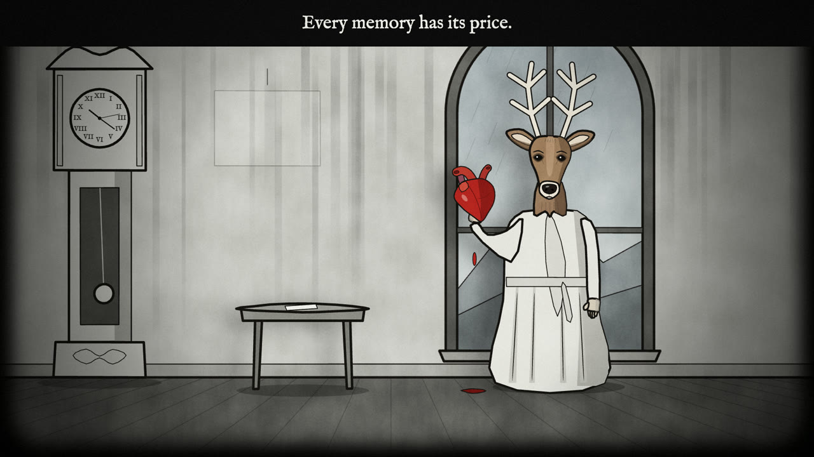
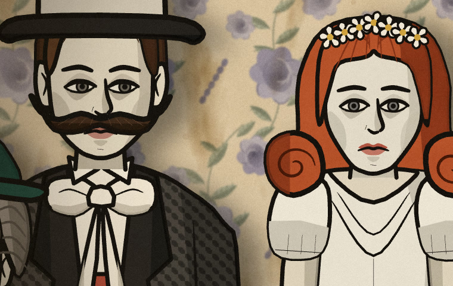
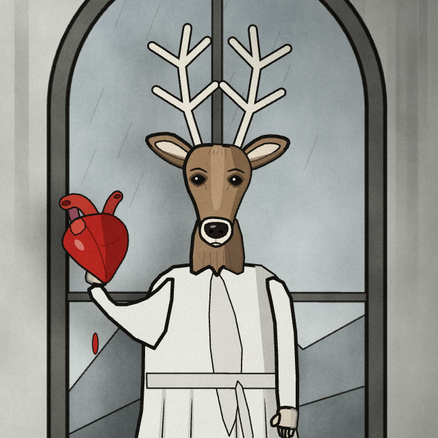

# rusty-lake-film

A Claude Code skill for making short films, stills and animated GIFs in the style of the later Rusty Lake games (Roots / Hotel / Paradise), entirely in code.

The look it produces:
- pale, deadpan characters with bold near-black outlines, flat fills and hard-edged cel shadows
- animal-headed and masked figures
- painterly backgrounds (faded rose wallpaper, painted walls)
- old-photo vignettes and a rounded black frame
- paper-puppet motion: one uncanny movement per shot (eyes turning to you, a slow head tilt, a beating heart)

Rendering: Canvas 2D, frame by frame in headless Chrome, encoded with ffmpeg, with a synthesized score timed to the beat.



*15-second sample made with this skill (GIF preview, reduced colours; the real output is a 1920×1080 MP4 with sound).*

| Family photograph (Roots) | Green hall (Hotel) | Grey room (Paradise) |
|---|---|---|
|  |  |  |

Full-size details:

| Faces | Animal head |
|---|---|
|  |  |

> Fan-made style study. It borrows the drawing style only: no Rusty Lake characters, logos or UI, and it is not affiliated with Rusty Lake.

## Install

```bash
git clone https://github.com/victoryuanxichen/rusty-lake-film.git ~/.claude/skills/rusty-lake-film
```

Claude Code picks it up automatically. Ask for "a Rusty Lake–style short film" or type `/rusty-lake-film`.

Requirements: Node 18+, ffmpeg, Google Chrome (or Chromium).

## Use it directly

```bash
bash ~/.claude/skills/rusty-lake-film/scripts/new_film.sh ./my-film --demo   # with the 3 example scenes
cd my-film
node render.mjs --audit --out=out/audit          # full-size check frames
node music/score.mjs                             # score
node render.mjs --frames --workers=4             # render
node render.mjs --encode --out=out/my-film.mp4   # MP4
```

## Contents

| Path | What |
|---|---|
| `SKILL.md` | Workflow, quality gate, must-follow rules |
| `references/style.md` | Style rules: line, cel shading, faces, hair, cloth, backgrounds, motion, transitions, three era recipes |
| `references/characters.md` | Character skeleton: proportions, face coordinate system, hair/hat alignment, bodies, hands, masks, animal heads, a copy-paste template |
| `references/kit-api.md` | API of the drawing kit |
| `references/checklist.md` | Review checklist + a table of every mistake made while building this |
| `references/engine.md` | Animation engine API |
| `template/` | Project skeleton: engine, renderer, score synth, `src/scenes/kit.js` |
| `examples/` | Family photograph, green hall with a maid, grey room with a deer-headed man and a beating heart |
| `scripts/new_film.sh` | Project scaffold |
| `docs/` | README images (not needed by the skill) |
